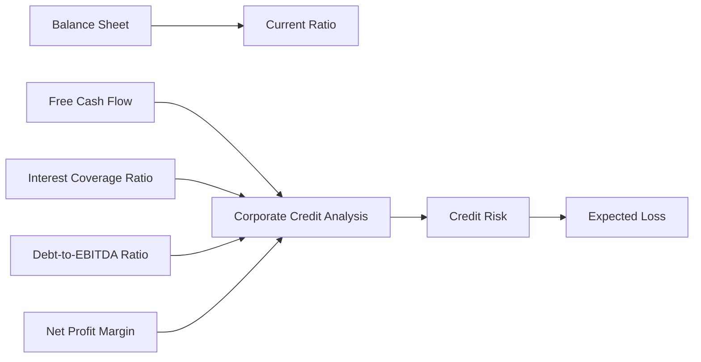

Open graph view

# Credit Analysis Bridge

This route makes the accounting-to-credit connection explicit:

## Navigate the route

1. Start with [[Corporate Credit Analysis]].
2. Follow coverage to [[Interest Coverage Ratio]] and leverage to [[Debt-to-EBITDA Ratio]].
3. Follow profitability to [[Net Profit Margin]] and cash generation to [[Free Cash Flow]].
4. Return to the [[Financial Statement Analysis]] map for calculations and to [[Fixed Income]] for credit interpretation.

